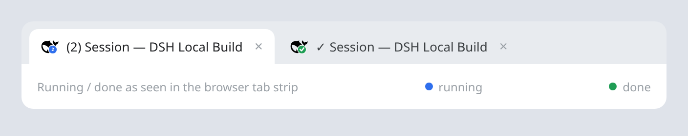

# dsh-tab-indicator

**English** | [简体中文](README.zh.md)

A [DeepSeek Harness](https://github.com/deepseek-ai/deepseek-harness) (DSH) web
plugin that puts the agent's running/done state on the browser tab, so you can
see from any other tab whether work is still running.



## Features

- **Live running badge** — while one or more root sessions run, the favicon
  shows a blue badge with the count (`1`, `2`, … `9+`).
- **Count instead of a dot** — a single run leaves the title untouched; `(N)`
  appears only when more than one run is active. There is no title dot.
- **Done check** — when a run finishes, the tab shows a green check for about a
  second. If other runs remain, the count badge comes back; if none remain, the
  check stays only while the tab is hidden or the window is unfocused and clears
  when you return.
- **Static by design** — the favicon is repainted only when the count or the
  running/done state changes. This avoids Chrome restarting its own favicon
  loading indicator on every frame, which makes the bookmark icon churn.
- **Theme aware** — uses the light or dark favicon variant the browser is
  currently showing, regenerates it when the color scheme changes, and restores
  the original `<link>` elements when idle.
- **No polling** — the host pushes a full snapshot over Server-Sent Events; the
  page catches up automatically after a host restart.
- **Local only** — no outbound requests and no DeepSeek API key.

## Requirements

- **DSH 0.2.1.x** with the web profile. Tested with `0.2.1-rc.3`.
- For development and tests, Node.js `^22.19.0 || >=24.0.0` (the DSH
  requirement).
- No DeepSeek API key: the plugin never calls an external service.

## Install

Install this repository directly from GitHub:

```bash
dsh plugin --profile web add github:zz0-0/dsh-tab-indicator
systemctl --user restart dsh-web
```

Or with an explicit git URL:

```bash
dsh plugin --profile web add git+https://github.com/zz0-0/dsh-tab-indicator.git
systemctl --user restart dsh-web
```

Then **hard-refresh** the DSH web page (`Ctrl/Cmd + Shift + R`). The plugin
injects its browser script into the DSH index page, so the refresh is needed the
first time. The `systemctl` line assumes the Linux user service; if you run
`dsh web` manually, restart that process instead.

### Local development install

```bash
dsh plugin --profile web add link:/path/to/dsh-tab-indicator-plugin
systemctl --user restart dsh-web
```

### Update

```bash
dsh plugin --profile web add github:zz0-0/dsh-tab-indicator
systemctl --user restart dsh-web
```

### Remove

```bash
dsh plugin --profile web remove dsh-tab-indicator
systemctl --user restart dsh-web
```

## Usage

- While one or more root sessions run, the favicon shows a blue count badge
  (`1`, `2`, … `9+`). The tab title is unchanged for one run and gets `(N)` when
  more than one run is active.
- When a run finishes, the tab shows a green check for about a second. If other
  runs are still active, the count badge returns. If nothing remains, the check
  stays only while the tab is hidden or the window is unfocused; it clears when
  you return.
- The count is global to the DSH host, not limited to the current workspace; a
  run in another session still counts.
- Subagent turns are part of their root turn and do not add to the count.
- The count is **turn-level**. A background job that outlives its turn is not
  counted; see [Limitations](#limitations).
- No polling: the host pushes a complete snapshot over SSE, and the browser
  catches up after a host restart.
- The page title is owned by React (`DocumentTitle`). A `MutationObserver`
  re-applies the `(N)` / `✓` decoration whenever the application rewrites the
  title.
- The favicon is intentionally static between state changes; see
  [Why the favicon is static](#why-the-favicon-is-static).

## Why the favicon is static

The icon is repainted only when the running count or the running/done state
changes. It is intentionally not animated between those changes.

Chrome treats every `<link rel="icon">` href change as a fresh favicon load. Its
own loading indicator — including the one on the bookmark bar — restarts for
each load, so a continuously animated favicon makes the bookmark icon churn.
Chrome has no native animated favicon (GIF favicons show the first frame only,
and SVG/CSS animation is ignored), so there is no way to animate the icon
without that reload behavior. A static badge is the deliberate trade-off.

## How it works

The plugin is a DSH bundle: `package.json` declares
`dsh.bundle.patch = ./cordis.patch.yml`, and that patch inserts the
`dsh-tab-indicator` entry into the web profile. It has two halves:

| Half | File | Role |
|---|---|---|
| Host | `lib/index.js` | Tracks running root agents, publishes the SSE snapshot, serves `GET /dsh-tab-indicator/events` and `GET /dsh-tab-indicator/client.js`, and injects the client into the index page. |
| Browser | `client.js` | Injected into the DSH index page. Consumes SSE, decorates the title, and paints the static count/check badge over the page's favicon. |

The SSE snapshot is small:

```
GET /dsh-tab-indicator/events   text/event-stream
data: {"type":"state","running":1,"sessions":["…"],"at":…}
```

- `ctx.agents.roots()` seeds the snapshot for agents that are already running
  when the plugin loads.
- `agent/status` (`idle` / `running`) and `agent/disposed` keep it current.
- A 2-second reconciliation against `ctx.agents.roots()` repairs a transition
  missed across a plugin reload and removes a session whose agent is no longer
  running.
- `connection.requestRejection` guards the stream with the same browser cookie
  used by the rest of the Web API.
- `ctx.webServer.tapIndex` inserts
  `<script defer src="/dsh-tab-indicator/client.js?v=1">`.

The browser half (`client.js`) consumes the stream, decorates the title, and
paints a count/check badge on a 64×64 canvas over the page's original favicon.
It repaints only when the count or state changes.

## Privacy

- **No outbound requests** — the host makes no network calls, and the plugin
  needs no DeepSeek API key.
- **Local only** — the browser only talks to your local DSH server: the SSE
  stream, the injected client script, and the page's own favicon asset used to
  draw the badge.
- **No telemetry** and no credential handling.

## Troubleshooting

- **No badge after install** — restart `dsh-web` and hard-refresh the page;
  confirm the profile lists `dsh-tab-indicator`.
- **The count stays after a chat finished** — first check whether another root
  session or background turn is still active. The host reconciles every 2
  seconds; if the running host predates that fix, restart `dsh-web`.
- **The favicon does not return to normal** — reload the page. Bookmark icons
  can lag behind the tab icon because the browser caches them.
- **There is no animation** — intentional, see
  [Why the favicon is static](#why-the-favicon-is-static).
- **The badge shows `9+`** — more than nine root sessions are running.

## Development

The plugin has no build step: plain ESM on the host and a classic browser
script.

```bash
git clone https://github.com/zz0-0/dsh-tab-indicator.git
cd dsh-tab-indicator
dsh plugin --profile web add link:$(pwd)
systemctl --user restart dsh-web
```

- `client.js` is served with `Cache-Control: no-store`. With a `link:` install,
  edit and hard-refresh the browser.
- `lib/index.js` is host-side: edit and restart `dsh-web`.
- A git install keeps its own copy under the profile's `node_modules`; reinstall
  the plugin (or sync `client.js` into the installed package) after editing the
  checkout.

### Files

| File | Role |
|---|---|
| `package.json` | DSH bundle metadata |
| `cordis.patch.yml` | Inserts the plugin into the web profile |
| `lib/index.js` | Host: agent tracking, SSE route, client injection |
| `client.js` | Browser: title count/check, static favicon badge, flash/done state |
| `test/host.test.mjs` | Node tests for the host half |
| `test/browser.test.mjs` | Chromium test for title/favicon/done behavior |
| `screenshot.png` | README screenshot |

### UI integration

The browser half does not patch React. It uses the stable browser surfaces:

- `link[rel~="icon"]`, including the `media="(prefers-color-scheme: …)"` light
  and dark variants supplied by the DSH page
- `document.title`, which `DocumentTitle` owns; a `MutationObserver` keeps the
  `(N)` / `✓` decoration after the application rewrites it
- `/dsh-tab-indicator/events` for the host snapshot
- `ctx.webServer.tapIndex` for the injected client script

### Tests

Run the host tests:

```bash
node --test test/host.test.mjs
```

Run the browser test (point the variables at a local Playwright core and
Chromium; the DSH development checkout ships both):

```bash
PLAYWRIGHT_CORE=/path/to/playwright-core/index.mjs \
CHROMIUM_PATH=/path/to/chromium \
node --test test/browser.test.mjs
```

Generated test artifacts land in `test/out/` and are git-ignored.

## Limitations

- It tracks **turn-level** activity. A background job that outlives its turn is
  not counted; adding the jobs service would be the next step if that matters.
- It is a Web-profile plugin: it needs `webServer` and `agents`.
- The favicon is a `data:image/png` URL. If a deployment adds a Content Security
  Policy, `img-src` must allow `data:` (the current Web index has no CSP).
- A fully closed browser cannot show anything, by definition.
- The favicon is static between state changes; see
  [Why the favicon is static](#why-the-favicon-is-static).

## License

[MIT](LICENSE)
