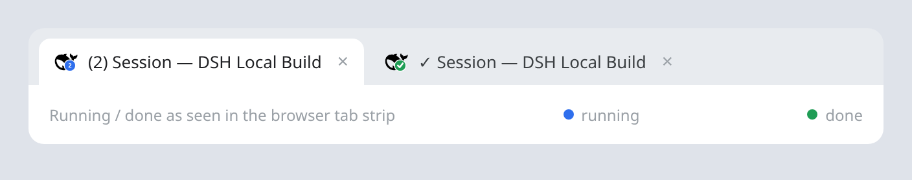

# dsh-tab-indicator

[English](README.md) | **简体中文**

一个 [DeepSeek Harness](https://github.com/deepseek-ai/deepseek-harness)（DSH）
Web 插件：把 agent 的运行/完成状态放到浏览器标签页上，这样切到其他标签页时也能
看到工作是否还在进行。



## 功能

- **运行徽章** — 有一个或多个根级会话在运行时，favicon 显示带数量的蓝色徽章
  （`1`、`2`……`9+`）。
- **数量而不是圆点** — 只有一个运行时不改标题；多于一个时才加 `(N)`。没有标题
  圆点。
- **完成对勾** — 运行结束时，标签页显示约一秒的绿色对勾。如果还有其他运行，数量
  徽章会恢复；如果没有，对勾只在标签页隐藏或窗口失焦时保留，回来后自动清除。
- **刻意静态** — favicon 只在数量或运行/完成状态变化时重绘。这样避免 Chrome
  把每一帧都当成新的 favicon 加载、导致书签图标不断闪烁。
- **明暗主题** — 使用浏览器当前显示的 light/dark favicon 变体；主题切换时重新
  生成；空闲时恢复原始 `<link>` 元素。
- **无轮询** — Host 通过 Server-Sent Events 推送完整快照；Host 重启后页面会自动
  追上。
- **仅本地** — 不发起对外请求，也不需要 DeepSeek API Key。

## 环境要求

- **DSH 0.2.1.x**，并启用 Web profile。已在 `0.2.1-rc.3` 上测试。
- 开发与测试使用 Node.js `^22.19.0 || >=24.0.0`（DSH 的要求）。
- 不需要 DeepSeek API Key：插件不访问任何外部服务。

## 安装

直接从 GitHub 安装：

```bash
dsh plugin --profile web add github:zz0-0/dsh-tab-indicator
systemctl --user restart dsh-web
```

或使用显式 git 地址：

```bash
dsh plugin --profile web add git+https://github.com/zz0-0/dsh-tab-indicator.git
systemctl --user restart dsh-web
```

然后 **硬刷新** DSH 页面（`Ctrl/Cmd + Shift + R`）。插件会把浏览器脚本注入 DSH
首页，所以第一次安装后需要刷新。上面的 `systemctl` 假设使用 Linux 用户服务；如果
直接运行 `dsh web`，请重启该进程。

### 本地开发安装

```bash
dsh plugin --profile web add link:/path/to/dsh-tab-indicator-plugin
systemctl --user restart dsh-web
```

### 更新

```bash
dsh plugin --profile web add github:zz0-0/dsh-tab-indicator
systemctl --user restart dsh-web
```

### 卸载

```bash
dsh plugin --profile web remove dsh-tab-indicator
systemctl --user restart dsh-web
```

## 使用

- 有一个或多个根级会话在运行时，favicon 显示蓝色数量徽章（`1`、`2`……`9+`）。
  只有一个运行时会保持标题不变；多于一个时才加 `(N)`。
- 运行结束时，标签页显示约一秒的绿色对勾。如果还有其他运行，数量徽章恢复；如果
  没有，对勾只在标签页隐藏或窗口失焦时保留，回来后清除。
- 计数是 DSH Host 全局的，不限于当前工作区；其他会话里的运行也会计入。
- 子 agent 的轮次属于其根轮次，不额外增加数量。
- 计数是 **轮次级** 的。运行结束后仍在继续的后台任务不会计入；见
  [限制](#限制)。
- 无轮询：Host 通过 SSE 推送完整快照，浏览器在 Host 重启后会自动追上。
- 页面标题由 React（`DocumentTitle`）管理。应用重写标题后，`MutationObserver`
  会重新应用 `(N)` / `✓` 装饰。
- favicon 在状态变化之间是刻意静态的；见
  [为什么 favicon 是静态的](#为什么-favicon-是静态的)。

## 为什么 favicon 是静态的

图标只在运行数量或运行/完成状态变化时重绘，状态不变时不会播放动画。

Chrome 会把每次 `<link rel="icon">` 的 href 变化当作一次新的 favicon 加载。它
自己的加载指示器——包括书签栏上的那个——会为每次加载重新开始，所以连续的 favicon
动画会让书签图标不断闪烁。Chrome 没有原生动画 favicon（GIF 只显示第一帧，
SVG/CSS 动画会被忽略），因此无法在避免这种重新加载的同时做动画。静态徽章是刻意
的取舍。

## 工作原理

本插件是一个 DSH bundle：`package.json` 声明
`dsh.bundle.patch = ./cordis.patch.yml`，该 patch 把 `dsh-tab-indicator` 条目
插入 web profile。它分为两部分：

| 部分 | 文件 | 作用 |
|---|---|---|
| Host | `lib/index.js` | 跟踪运行中的根级 agent，发布 SSE 快照，提供 `GET /dsh-tab-indicator/events` 与 `GET /dsh-tab-indicator/client.js`，并把客户端脚本注入首页。 |
| 浏览器侧 | `client.js` | 注入 DSH 首页。消费 SSE，装饰标题，并在页面原始 favicon 上绘制静态的数量/对勾徽章。 |

SSE 快照很小：

```
GET /dsh-tab-indicator/events   text/event-stream
data: {"type":"state","running":1,"sessions":["…"],"at":…}
```

- `ctx.agents.roots()` 为插件加载时已经在运行的 agent 提供初始快照。
- `agent/status`（`idle` / `running`）与 `agent/disposed` 保持其更新。
- 每 2 秒与 `ctx.agents.roots()` 对账一次，修复插件重载时错过的状态转换，并移除
  已经不再运行的会话。
- `connection.requestRejection` 使用与 Web API 其余部分相同的浏览器 cookie 保护
  该流。
- `ctx.webServer.tapIndex` 注入
  `<script defer src="/dsh-tab-indicator/client.js?v=1">`。

浏览器侧（`client.js`）消费该流、装饰标题，并在 64×64 画布上把数量/对勾徽章绘制
到页面原始 favicon 上。只有数量或状态变化时才重绘。

## 隐私

- **无对外请求** — Host 不发起任何网络请求，插件也不需要 DeepSeek API Key。
- **仅本地** — 浏览器只与本地 DSH 服务通信：SSE 流、注入的客户端脚本，以及用于
  合成徽章的页面自身 favicon 资源。
- **无遥测**，也不处理凭据。

## 常见问题

- **安装后看不到徽章** — 重启 `dsh-web` 并硬刷新页面；确认 profile 中列出了
  `dsh-tab-indicator`。
- **会话结束后数量仍然存在** — 先确认是否还有另一个根级会话或后台轮次在运行。
  Host 每 2 秒对账一次；如果运行中的 host 代码早于该修复，请重启 `dsh-web`。
- **favicon 没有恢复正常** — 刷新页面。书签图标可能因为浏览器缓存而滞后于标签页
  图标。
- **没有动画** — 这是刻意的，见
  [为什么 favicon 是静态的](#为什么-favicon-是静态的)。
- **徽章显示 `9+`** — 同时运行的根级会话超过九个。

## 开发

插件没有构建步骤：Host 侧是普通 ESM，浏览器侧是传统脚本。

```bash
git clone https://github.com/zz0-0/dsh-tab-indicator.git
cd dsh-tab-indicator
dsh plugin --profile web add link:$(pwd)
systemctl --user restart dsh-web
```

- `client.js` 以 `Cache-Control: no-store` 提供。使用 `link:` 安装时，修改后硬刷新
  浏览器即可。
- `lib/index.js` 是 Host 侧代码：修改后重启 `dsh-web`。
- 通过 git 安装时，profile 的 `node_modules` 里会保留一份独立副本；修改 checkout
  后需要重新安装插件（或把 `client.js` 同步到已安装的包）再刷新。

### 文件

| 文件 | 作用 |
|---|---|
| `package.json` | DSH bundle 元数据 |
| `cordis.patch.yml` | 把插件插入 web profile |
| `lib/index.js` | Host：agent 跟踪、SSE 路由、客户端注入 |
| `client.js` | 浏览器侧：标题数量/对勾、静态 favicon 徽章、完成/空闲状态 |
| `test/host.test.mjs` | Host 侧的 Node 测试 |
| `test/browser.test.mjs` | 标题/favicon/完成行为的 Chromium 测试 |
| `screenshot.png` | README 截图 |

### UI 集成

浏览器侧不修改 React，只使用稳定的浏览器接口：

- `link[rel~="icon"]`，包括 DSH 页面提供的
  `media="(prefers-color-scheme: …)"` 明/暗变体
- `document.title`，由 `DocumentTitle` 管理；应用重写标题后，`MutationObserver`
  会重新应用 `(N)` / `✓` 装饰
- `/dsh-tab-indicator/events` 用于 Host 快照
- `ctx.webServer.tapIndex` 用于注入客户端脚本

### 测试

运行 Host 测试：

```bash
node --test test/host.test.mjs
```

运行浏览器测试（把变量指向本地的 Playwright core 与 Chromium；DSH 开发 checkout
自带这两者）：

```bash
PLAYWRIGHT_CORE=/path/to/playwright-core/index.mjs \
CHROMIUM_PATH=/path/to/chromium \
node --test test/browser.test.mjs
```

测试产物写入 `test/out/`，已被 git 忽略。

## 限制

- 只跟踪 **轮次级** 活动。运行结束后仍在继续的后台任务不会计入；如果这很重要，
  下一步可以接入 jobs 服务。
- 这是 Web profile 插件：需要 `webServer` 与 `agents`。
- favicon 是 `data:image/png` URL。如果部署添加了内容安全策略（CSP），
  `img-src` 必须允许 `data:`（当前 Web 首页没有 CSP）。
- 浏览器完全关闭时无法显示任何内容，这是定义使然。
- favicon 在状态变化之间是静态的；见
  [为什么 favicon 是静态的](#为什么-favicon-是静态的)。

## 许可证

[MIT](LICENSE)
